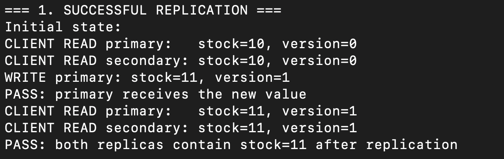
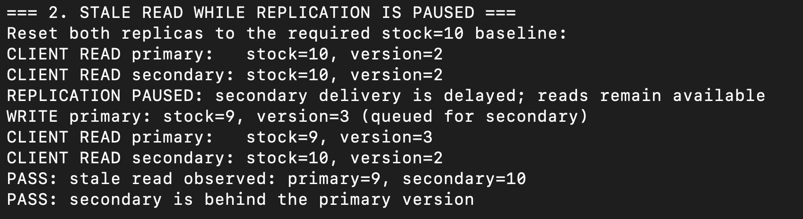
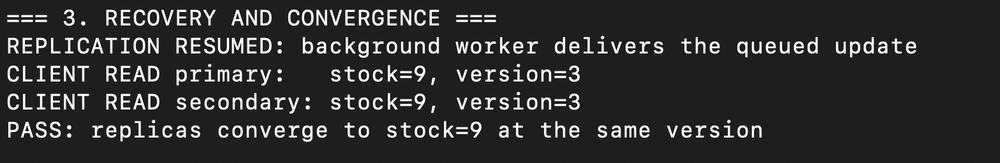

# Module 8: Replication & Consistency

A Python inventory simulation with one primary replica, one secondary replica, and a client that reads either replica. Writes update the primary immediately and enter an ordered queue for asynchronous propagation to the secondary. The demonstration verifies successful replication, a stale read during delayed replication, and convergence when replication resumes.

## Run

Requires Python 3.10 or later. Uses only the Python standard library; no packages or services are required.

```sh
git clone https://github.com/SuprithaMallaradhya/CMPE-273-Module-8-Replication-Consistency.git
cd CMPE-273-Module-8-Replication-Consistency
python3 main.py
```

The program runs all three scenarios automatically and exits. Each run starts with stock `10`; failed checks or replication timeouts cause a nonzero exit status.

Run the automated checks:

```sh
python3 -m unittest -v
```

## Architecture

```text
                     write(stock)
              +------------------------+
              |                        v
        +-----------+ read       +-----------+
        |  Client   |----------->|  Primary  |
        | main.py   |            | stock, v  |
        +-----------+            +-----------+
              |                        |
              | read                   | enqueue immutable update
              v                        v
        +-----------+            +------------------+
        | Secondary |<-----------| FIFO queue +     |
        | stock, v  |   apply    | background worker|
        +-----------+            +------------------+
                                  pause / resume
```

`inventory.py` implements both replicas as independent in-memory snapshots and runs the replication worker in a separate thread. Only primary writes are accepted. Each write increments a version, and the worker applies queued snapshots in order. A condition variable protects state, coordinates delivery, and allows the client to wait for a particular version with a bounded timeout.

Pausing replication suspends delivery while retaining queued updates; client reads and primary writes remain available. This models a delayed replication link, with no wall-clock sleep needed to reproduce the stale read. Recovery resumes the worker and drains pending updates. This is a single-process simulation: it does not implement network transport, failover, durable storage, or recovery after process loss.

## Results and evidence

The following terminal output was captured from an actual execution of `python3 main.py`. The same transcript is included in [evidence/demo-output.txt](evidence/demo-output.txt).

1. **Replication:** the primary accepts stock `11` at version `1`; the secondary eventually reaches the same stock and version.
2. **Stale read:** both replicas first reach stock `10` at version `2`. Replication is paused, then the primary accepts stock `9` at version `3`. The secondary still returns stock `10`, version `2`.
3. **Recovery:** replication resumes and the queued update reaches the secondary. Both replicas return stock `9`, version `3`.

```text
MODULE 8: REPLICATION & CONSISTENCY
One primary | One secondary | Client-selectable reads

=== 1. SUCCESSFUL REPLICATION ===
Initial state:
CLIENT READ primary:   stock=10, version=0
CLIENT READ secondary: stock=10, version=0
WRITE primary: stock=11, version=1
PASS: primary receives the new value
CLIENT READ primary:   stock=11, version=1
CLIENT READ secondary: stock=11, version=1
PASS: both replicas contain stock=11 after replication

=== 2. STALE READ WHILE REPLICATION IS PAUSED ===
Reset both replicas to the required stock=10 baseline:
CLIENT READ primary:   stock=10, version=2
CLIENT READ secondary: stock=10, version=2
REPLICATION PAUSED: secondary delivery is delayed; reads remain available
WRITE primary: stock=9, version=3 (queued for secondary)
CLIENT READ primary:   stock=9, version=3
CLIENT READ secondary: stock=10, version=2
PASS: stale read observed: primary=9, secondary=10
PASS: secondary is behind the primary version

=== 3. RECOVERY AND CONVERGENCE ===
REPLICATION RESUMED: background worker delivers the queued update
CLIENT READ primary:   stock=9, version=3
CLIENT READ secondary: stock=9, version=3
PASS: replicas converge to stock=9 at the same version

ALL DEMONSTRATIONS PASSED
```

## Screenshots

### Successful replication

The primary accepts stock `11`, and the secondary reaches the same value and version after replication.



### Stale read during delayed replication

With replication paused, the primary returns stock `9` at version `3` while the secondary still returns stock `10` at version `2`.



### Recovery and convergence

After replication resumes, both replicas return stock `9` at version `3`, and all demonstration checks pass.



## Verification

The tests check successful propagation, stale reads while replication is paused, a timeout while delivery is suspended, recovery after resuming, convergence after multiple queued writes, and invalid input handling. Matching versions verify that the secondary has received the latest update even when stock values repeat.

Captured test output is also available in [evidence/test-output.txt](evidence/test-output.txt).

```text
test_invalid_inputs (test_inventory.InventoryTests) ... ok
test_queued_writes_converge_to_latest_version (test_inventory.InventoryTests) ... ok
test_stale_read_and_recovery (test_inventory.InventoryTests) ... ok
test_successful_replication (test_inventory.InventoryTests) ... ok

----------------------------------------------------------------------
Ran 4 tests in 0.026s

OK
```

## Reflection

Reading from a nearby replica can reduce latency and spread read load, but asynchronous replication means that replica may return an older inventory value. In this simulation, the secondary returns stock `10` even after the primary has accepted stock `9`. Guaranteeing the latest value requires coordination, such as reading from the primary or waiting until the secondary has applied the required version, which can increase latency or block during a replication delay. The appropriate tradeoff depends on whether the application can tolerate temporarily stale data or needs the latest value before making a decision.

## Repository contents

| File | Purpose |
| --- | --- |
| `inventory.py` | Replica state, primary writes, client reads, and replication worker |
| `main.py` | Reproducible demonstration with explicit pass/fail checks |
| `test_inventory.py` | Automated behavioral tests |
| `evidence/demo-output.txt` | Captured demonstration output |
| `evidence/test-output.txt` | Captured test results |
| `evidence/01-replication.png` | Successful replication screenshot |
| `evidence/02-stale-read.png` | Stale-read screenshot |
| `evidence/03-convergence.png` | Recovery and convergence screenshot |
